# Server Hardening Workflow

Workflow ini mengimplementasikan siklus keamanan resmi bawaan Antigravity: **Audit $\rightarrow$ Action $\rightarrow$ Evaluasi**.

---

## 1. Arsitektur Siklus

```mermaid
flowchart LR
    A["scripts/audit/ (Read-Only)"] -->|"Simpan log & ports_state.json"| B["server/<server>/audit/"]
    B -->|"AI Match dengan foundation/"| C["scripts/action/ (Perbaikan)"]
    C -->|"Persetujuan User & Eksekusi"| D["server/<server>/action/"]
    D -->|"Validasi Hasil"| E["scripts/evaluasi/ (Verifikasi)"]
    E -->|"Log Bukti Hasil"| F["server/<server>/evaluasi/"]
```

---

## 2. Struktur Direktori
- **`foundation/`**: Sumber kebenaran tunggal (*Single Source of Truth* / SOP umum berdasarkan 3 pilar: Incident Triage, Ports/Firewall, Auth/SSH).
- **`scripts/audit/`**: Skrip pemeriksaan (`check_ports.sh`, `check_triage.sh`, `check_ssh_users.sh`).
- **`scripts/action/`**: Skrip tindakan (`backup_configs.sh`, `harden_ports.sh`, `create_developer_user.sh`).
- **`scripts/evaluasi/`**: Skrip verifikasi (`verify_ports.sh`).
- **`server/<server_name>/`**: Folder log dan data state riil per server:
  - `audit/`: Log audit + `ports_state.json` (memori port dan koneksi aktif).
  - `action/`: Log eksekusi dan bukti backup.
  - `evaluasi/`: Log verifikasi pasca-tindakan.
- **`security-hardening.sh`**: Runner otomatis untuk mengeksekusi skrip ke target via SSH.

---

## 3. SOP Interaksi Agent dengan Pengguna

1. **Tahap Audit:**
   - Jalankan `./security-hardening.sh <server> check_ports`.
   - Baca output log dan `server/<server>/audit/ports_state.json`.
   - Laporkan temuan ke pengguna secara ringkas, tanpa emoticon berlebihan.
2. **Tahap Action:**
   - Cocokkan data `ports_state.json` dengan `foundation/02-network-and-ports.md`.
   - Sajikan rencana tindakan (port apa yang ditutup, IP mana yang di-whitelist) kepada pengguna.
   - **TUNGGU PERSETUJUAN PENGGUNA.** Jangan eksekusi skrip action tanpa izin eksplisit.
   - Sebelum hardening, selalu jalankan backup: `./security-hardening.sh <server> backup_configs`.
   - Jalankan hardening: `./security-hardening.sh <server> harden_ports`.
3. **Tahap Evaluasi:**
   - Jalankan verifikasi: `./security-hardening.sh <server> verify_ports`.
   - Sajikan scorecard verifikasi kepada pengguna untuk memastikan port sudah tertutup dan aplikasi tetap berjalan normal.

---

## 4. Aturan Keselamatan (Safety First)
1. **Dilarang Menutup Port Membabi Buta:** Selalu rujuk `ports_state.json` untuk melihat IP internal yang membutuhkan akses (seperti IP `10.0.0.1` ke Postgres).
2. **Wajib Backup:** Selalu jalankan `backup_configs` sebelum mengubah file konfigurasi atau firewall.
3. **Anti-Lockout SSH:** Pastikan port SSH (port 22 atau kustom) diizinkan di firewall sebelum mengaktifkan UFW.
