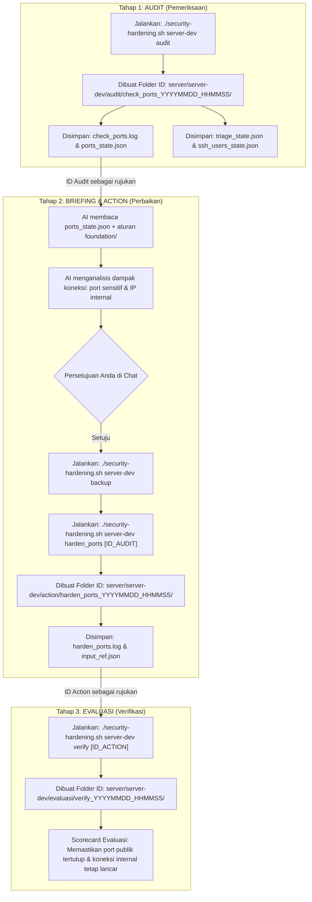

# 🛡️ Security Hardening Agent

Repositori ini adalah sistem automasi audit, perbaikan (*hardening*), dan verifikasi keamanan server Linux berbasis AI (**Antigravity**) dengan mengadopsi siklus kerja standar industri: **Audit $\rightarrow$ Action $\rightarrow$ Evaluasi**.

Setiap proses eksekusi diisolasi ke dalam **ID Direktori unik** yang berfungsi sebagai jembatan memori antar-tahap, memastikan tidak ada data yang tercecer dan memiliki riwayat audit (*audit trail*) yang jelas.

---

## 📁 Struktur Direktori & Penjelasan File

```text
security-agent/
├── .agents/                                  # Konfigurasi & Otak Bawaan AI Antigravity
│   └── skills/
│       └── server-hardening/
│           └── SKILL.md                      # Workflow & SOP resmi AI Antigravity (Memory Agent)
│
├── foundation/                               # Buku Pedoman & SOP Baku (Single Source of Truth)
│   ├── 01-incident-triage.md                 # SOP & checklist deteksi backdoor, cron, dan penyusup
│   ├── 02-network-and-ports.md               # SOP port 0.0.0.0, Docker iptables gotchas, & firewall
│   └── 03-auth-and-ssh.md                    # SOP pembuatan akun developer & hardening SSH key
│
├── scripts/                                  # Kumpulan Skrip Alat Kerja (Sederhana & Ringkas)
│   ├── audit/                                # [TAHAP 1: PEMERIKSAAN / READ-ONLY]
│   │   ├── check_ports.sh                    # Cek port sensitif 0.0.0.0 & Analisis dampak koneksi aktif (DIGABUNG)
│   │   ├── check_triage.sh                   # Cek sisa cron backdoor, authorized_keys, proses /tmp
│   │   └── check_ssh_users.sh                # Cek konfigurasi daemon SSH & privilege user / sudoers
│   │
│   ├── action/                               # [TAHAP 2: TINDAKAN / PERBAIKAN]
│   │   ├── backup.sh                         # Cadangkan config OS + Dump Database + Docker Compose (DIGABUNG)
│   │   ├── harden_ports.sh                   # Terapkan UFW default deny & whitelist IP internal (Anti-gangguan)
│   │   ├── migrate_old_ip.sh                 # Migrasi IP lama .70 ke IP baru .32 di seluruh file .env (Auto-backup)
│   │   └── create_developer_user.sh          # Buat akun developer baru & generate keypair otomatis
│   │
│   └── evaluasi/                             # [TAHAP 3: EVALUASI / VERIFIKASI]
│       └── verify.sh                         # Scorecard validasi kelulusan menyeluruh (DIGABUNG)
│
├── server/                                   # Database Log & State Nyata per Server
│   ├── server-dev/
│   │   ├── audit/
│   │   │   └── check_ports_20261015_133703/  # Direktori ID unik per sesi audit
│   │   │       ├── check_ports.log           # Log lengkap pemeriksaan
│   │   │       └── ports_state.json          # Data terstruktur (port terbuka & IP whitelist)
│   │   ├── action/
│   │   │   └── harden_ports_20261015_134000/ # Direktori ID unik per sesi tindakan
│   │   │       ├── harden_ports.log          # Log bukti eksekusi perbaikan
│   │   │       └── input_ref.json            # Referensi ID audit yang dirujuk
│   │   └── evaluasi/
│   │       └── verify_ports_20261015_134500/ # Direktori ID unik per sesi evaluasi
│   │           ├── verify_ports.log          # Log scorecard kelulusan
│   │           └── input_ref.json            # Referensi ID tindakan yang divalidasi
│   └── server-prod/                          # (Struktur serupa untuk server lainnya)
│
├── security-hardening.sh                     # Mesin Penggerak / Runner CLI Utama (JANGAN DIHAPUS)
├── .env.example                              # Template penyimpanan password/kredensial SSH
├── .env                                      # File kredensial lokal Anda (Otomatis di-ignore Git)
├── .gitignore                                # Proteksi agar log, json, dan password tidak masuk Git
└── README.md                                 # Dokumentasi arsitektur dan alur kerja proyek
```

---

## 🔄 Alur Lengkap Project (The Security Flow)

Alur kerja proyek ini menghubungkan tiga pilar siklus secara berantai menggunakan **ID Direktori**:



---

### Penjelasan Rinci Tiap Tahapan:

### 1. Tahap Audit (Pemeriksaan / Discovery)
* **Tujuan:** Mengambil potret kondisi riil server saat ini secara *read-only* tanpa mengubah sistem.
* **Perintah yang dijalankan:**
  ```bash
  # Menjalankan seluruh audit otomatis (Port + Dampak Koneksi, Triage Backdoor, dan Akun/SSH)
  ./security-hardening.sh server-dev audit

  # ATAU jalankan satuan:
  ./security-hardening.sh server-dev check_ports
  ./security-hardening.sh server-dev check_triage
  ./security-hardening.sh server-dev check_ssh_users
  ```
* **Hasil di File System:**
  Sistem membuat folder ID unik:
  `server/server-dev/audit/check_ports_YYYYMMDD_HHMMSS/`
  Di dalamnya tersimpan log bersih dan file state memori (`ports_state.json`, `triage_state.json`, `ssh_users_state.json`).

#### 🔍 Dasar Deteksi Cron Job: "Mencurigakan" vs "Bersih" (`check_triage.sh`)
Skrip `check_triage.sh` memeriksa seluruh lokasi crontab di sistem Linux:
- `/etc/crontab` (Cron utama OS)
- `/etc/cron.d/*` (Cron modular aplikasi)
- `/var/spool/cron/crontabs/*` (Cron milik user root dan seluruh user biasa)

**Pola yang Dilabeli "Mencurigakan" (Indikator Backdoor / Malware):**
Sebuah tugas cron akan diberi tanda **PERINGATAN (Mencurigakan)** jika baris perintahnya mengandung pola *malicious persistence* yang lazim dipakai penyerang pasca-serangan:
1. **Download & Eksekusi Otomatis:** Perintah `curl` atau `wget` yang langsung di-pipe ke shell (contoh: `curl ... | bash` atau `wget ... -O- | sh`).
2. **Reverse Shell:** Membuka koneksi remote diam-diam menggunakan `nc -e`, `/dev/tcp`, `bash -i`, atau skrip socket `python`/`perl`.
3. **Eksekusi dari Folder Sementara:** Menjalankan script tersembunyi dari direktori `/tmp/`, `/dev/shm/`, atau `/var/tmp/`.

Jika tidak ditemukan pola-pola di atas, maka sistem menetapkan status **Bersih** (hanya berisi cron sistem standar seperti `cron.daily`, `disk-guard`, atau `docker-prune`).

---

### 2. Tahap Briefing & Action (Pencadangan & Perbaikan)
* **Tujuan:** Menutup celah keamanan port publik dan mengunci firewall tanpa memutus koneksi aplikasi maupun microservices.
* **Perintah yang dijalankan:**
  ```bash
  # Langkah A: Pencadangan Penuh (OS Config + Database Dump SQL + Docker Compose)
  ./security-hardening.sh server-dev backup

  # Langkah B: Kunci Port Publik & Aktifkan Firewall UFW dengan Whitelist VPC
  ./security-hardening.sh server-dev harden_ports

  # Langkah C (Opsional): Buat Akun Developer Baru beserta Keypair Otomatis
  ./security-hardening.sh server-dev create_developer_user <nama_user>
  ```

#### 🛡️ Proteksi Docker Microservices & Hairpin NAT (`harden_ports.sh`)
Banyak microservice Docker lokal di server yang memanggil database/Redis menggunakan IP publik server sendiri (misal: `POSTGRES_HOST=163.128.54.32`).
Di Linux, koneksi ini melewati mekanisme **Docker Hairpin NAT**.

Agar microservices tersebut **tidak terblokir sama sekali oleh UFW**, skrip `harden_ports.sh` menerapkan whitelist berlapis:
1. **Subnet Docker Internal:** `172.16.0.0/12` (meliputi seluruh IP container `172.16.x.x` s/d `172.31.x.x`).
2. **Interface Bridge Docker:** `docker0` dan seluruh bridge kustom Docker compose (`br-+`).
3. **Loopback & Self Public IP:** Mengizinkan interface `lo` serta IP publik server itu sendiri (`163.128.54.32`) sehingga paket Hairpin NAT dari container lokal diizinkan tembus tanpa hambatan.
4. **Subnet Jaringan Internal VPC:** `10.0.0.0/8` dan `192.168.0.0/16` agar server rekanan tetap terhubung lancar.

---

### 3. Tahap Evaluasi (Verifikasi / Scorecard)
* **Tujuan:** Memvalidasi secara ilmiah bahwa celah sudah benar-benar tertutup dan membuktikan tidak ada aplikasi sah yang terputus.
* **Perintah yang dijalankan:**
  ```bash
  ./security-hardening.sh server-dev verify
  ```
* **Hasil di File System:**
  Dibuat folder ID: `server/server-dev/evaluasi/verify_YYYYMMDD_HHMMSS/`
  Sistem mengeluarkan **Scorecard Kelulusan 1 Lembar**:
  - `[LULUS]` Status Firewall UFW aktif dengan default policy DENY.
  - `[LULUS]` Akses manajemen SSH tetap terbuka (bebas risiko lockout).
  - `[LULUS]` Koneksi antar-server di jaringan internal VPC tetap berjalan normal.
  - `[LULUS]` Direktori `/tmp` dan crontab terbukti bersih dari jejak malware.
  - `[LULUS]` Akun ber-privilege UID 0 terbukti hanya akun root resmi.

---

## 🛠️ Ringkasan Perintah CLI (`./security-hardening.sh`)

| Tahap | Perintah | Fungsi | Input Rujukan |
| :--- | :--- | :--- | :--- |
| **Audit Full** | `./security-hardening.sh <server> audit` | Menjalankan seluruh audit (ports+impact, triage, ssh) | - |
| **Audit Port** | `./security-hardening.sh <server> check_ports` | Port sensitif 0.0.0.0 & Analisis dampak koneksi aktif (DIGABUNG) | - |
| **Audit Triage** | `./security-hardening.sh <server> check_triage` | Memeriksa sisa cron job asing, SSH key duplikat, dan malware | - |
| **Audit SSH** | `./security-hardening.sh <server> check_ssh_users` | Memeriksa aturan login SSH dan akun yang memiliki hak sudo | - |
| **Action Backup** | `./security-hardening.sh <server> backup` | Cadangkan config OS + Dump Database + Docker Compose (DIGABUNG) | - |
| **Action Harden** | `./security-hardening.sh <server> harden_ports [ID]` | Mengaktifkan UFW default deny + whitelist IP internal (Anti-gangguan) | `[ID_AUDIT]` (Opsional) |
| **Action User** | `./security-hardening.sh <server> create_developer_user <user>` | Buat akun developer baru & generate keypair (private+public) otomatis | Nama User |
| **Evaluasi** | `./security-hardening.sh <server> verify` | Scorecard evaluasi kelulusan menyeluruh (DIGABUNG) | - |

---

## 🔐 Keamanan Kredensial & Git
- File kredensial `.env` Anda **100% diabaikan oleh Git** melalui `.gitignore`.
- Seluruh isi folder log dan JSON di `server/<server>/*` tidak akan pernah ter-push ke repository publik.
- Script tidak menyimpan password hardcode; seluruh kredensial diambil dinamis dari `.env` lokal Anda.
