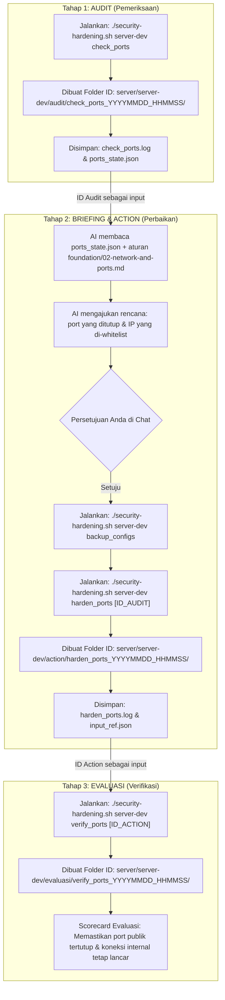

# 🛡️ Security Hardening Agent

Repositori ini adalah sistem automasi audit, perbaikan (*hardening*), dan verifikasi keamanan server Linux berbasis AI (**Antigravity**) dengan mengadopsi siklus kerja standar industri: **Audit $\rightarrow$ Action $\rightarrow$ Evaluasi**.

Setiap proses eksekusi diisolasi ke dalam **ID Direktori unik** yang berfungsi sebagai jembatan memori antar-tahap, memastikan tidak ada data yang tercecer dan memiliki riwayat audit (*audit trail*) yang jelas.

---

## 📁 Struktur Direktori & Penjelasan File

```text
security-agent/
├── .agents/                                  # Konfigurasi & Otak Bawaan AI Antigravity
│   └── skills/
│       └── server-hardening/
│           └── SKILL.md                      # Workflow & SOP resmi AI Antigravity (Memory Agent)
│
├── foundation/                               # Buku Pedoman & SOP Baku (Single Source of Truth)
│   ├── 01-incident-triage.md                 # SOP & checklist deteksi backdoor, cron, dan penyusup
│   ├── 02-network-and-ports.md               # SOP port 0.0.0.0, Docker iptables gotchas, & firewall
│   └── 03-auth-and-ssh.md                    # SOP pembuatan akun developer & hardening SSH key
│
├── scripts/                                  # Kumpulan Skrip Alat Kerja (Dibagi per Siklus)
│   ├── audit/                                # [TAHAP 1: PEMERIKSAAN / READ-ONLY]
│   │   ├── check_ports.sh                    # Cek port 0.0.0.0, status firewall UFW, & IP terhubung
│   │   ├── check_port_impact.sh              # Analisis dampak: cek apakah penutupan port memutus koneksi aktif
│   │   ├── check_triage.sh                   # Cek sisa cron backdoor, authorized_keys, proses /tmp
│   │   └── check_ssh_users.sh                # Cek konfigurasi daemon SSH & privilege user / sudoers
│   │
│   ├── action/                               # [TAHAP 2: TINDAKAN / PERBAIKAN]
│   │   ├── backup_databases.sh               # Dump seluruh database (Postgres host & Docker) + compose
│   │   ├── backup_configs.sh                 # Backup darurat config server (/etc/ssh, ufw, cron)
│   │   ├── harden_ports.sh                   # Terapkan UFW default deny & whitelist IP internal (Anti-gangguan)
│   │   └── create_developer_user.sh          # Buat akun developer baru & generate keypair otomatis
│   │
│   └── evaluasi/                             # [TAHAP 3: EVALUASI / VERIFIKASI]
│       ├── verify_ports.sh                   # Scorecard validasi: penutupan port & kontinuitas VPC
│       ├── verify_triage.sh                  # Scorecard validasi: kebersihan cron & direktori temp
│       └── verify_ssh.sh                     # Scorecard validasi: keamanan akun & status SSH daemon
│
├── server/                                   # Database Log & State Nyata per Server
│   ├── server-dev/
│   │   ├── audit/
│   │   │   └── check_ports_20261015_133703/  # Direktori ID unik per sesi audit
│   │   │       ├── check_ports.log           # Log lengkap pemeriksaan
│   │   │       └── ports_state.json          # Data terstruktur (port terbuka & IP whitelist)
│   │   ├── action/
│   │   │   └── harden_ports_20261015_134000/ # Direktori ID unik per sesi tindakan
│   │   │       ├── harden_ports.log          # Log bukti eksekusi perbaikan
│   │   │       └── input_ref.json            # Referensi ID audit yang dirujuk
│   │   └── evaluasi/
│   │       └── verify_ports_20261015_134500/ # Direktori ID unik per sesi evaluasi
│   │           ├── verify_ports.log          # Log scorecard kelulusan
│   │           └── input_ref.json            # Referensi ID tindakan yang divalidasi
│   └── server-prod/                          # (Struktur serupa untuk server lainnya)
│
├── security-hardening.sh                     # Mesin Penggerak / Runner CLI Utama (JANGAN DIHAPUS)
├── .env.example                              # Template penyimpanan password/kredensial SSH
├── .env                                      # File kredensial lokal Anda (Otomatis di-ignore Git)
├── .gitignore                                # Proteksi agar log, json, dan password tidak masuk Git
└── README.md                                 # Dokumentasi arsitektur dan alur kerja proyek
```

---

## 🔄 Alur Lengkap Project (The Security Flow)

Alur kerja proyek ini menghubungkan tiga pilar siklus secara berantai menggunakan **ID Direktori**:



---

### Penjelasan Rinci Tiap Tahapan:

### 1. Tahap Audit (Pemeriksaan / Discovery)
* **Tujuan:** Mengambil potret kondisi riil server saat ini secara *read-only* tanpa mengubah sistem.
* **Perintah yang dijalankan:**
  ```bash
  # Audit satuan (contoh: port jaringan)
  ./security-hardening.sh server-dev check_ports

  # ATAU Audit Lengkap sekaligus (ports, triage sisa backdoor, dan akun/SSH)
  ./security-hardening.sh server-dev audit
  ```
* **Hasil di File System:**
  Sistem membuat folder ID unik:
  `server/server-dev/audit/check_ports_YYYYMMDD_HHMMSS/`
  Di dalamnya tersimpan:
  1. `check_ports.log` $\rightarrow$ Tampilan bersih daftar port dan IP luar yang terhubung.
  2. `ports_state.json` $\rightarrow$ Data memori port sensitif (Postgres 5432, MySQL 3306, FerretDB 27017) dan IP rekanan internal (seperti `10.0.0.1`) yang **wajib di-whitelist**.

---

### 2. Tahap Briefing & Action (Perbaikan / Remediasi)
* **Tujuan:** Menutup celah keamanan yang ditemukan berdasarkan aturan baku di `foundation/` tanpa mengganggu operasional aplikasi.
* **Alur Memory:**
  AI Antigravity membaca `ports_state.json` dari folder ID audit tadi, lalu menyusun proposal tindakan yang aman untuk Anda tinjau:
  - Buka port 22 untuk SSH admin.
  - Whitelist IP `10.0.0.1` ke port PostgreSQL `5432`.
  - Tutup akses publik ke port database lainnya.
* **Perintah yang dijalankan:**
  ```bash
  # Langkah A: Backup konfigurasi penting terlebih dahulu
  ./security-hardening.sh server-dev backup_configs

  # Langkah B: Terapkan aturan hardening
  # (Bisa memasukkan ID audit secara spesifik, atau otomatis mengambil audit terbaru)
  ./security-hardening.sh server-dev harden_ports check_ports_20261015_133703
  ```
* **Hasil di File System:**
  Dibuat folder ID: `server/server-dev/action/harden_ports_YYYYMMDD_HHMMSS/`
  Di dalamnya tercatat `harden_ports.log` dan file `input_ref.json` yang mencatat ID audit asal rujukan tindakan tersebut.

---

### 3. Tahap Evaluasi (Verifikasi / Scorecard)
* **Tujuan:** Memvalidasi secara ilmiah bahwa celah sudah benar-benar tertutup dan membuktikan tidak ada aplikasi sah yang terputus.
* **Perintah yang dijalankan:**
  ```bash
  ./security-hardening.sh server-dev verify_ports
  ```
* **Hasil di File System:**
  Dibuat folder ID: `server/server-dev/evaluasi/verify_ports_YYYYMMDD_HHMMSS/`
  Sistem mengeluarkan **Scorecard Kelulusan**:
  - `[LULUS]` Status Firewall UFW aktif dengan default policy DENY.
  - `[LULUS]` Port database (3306, 5432, 27017, 6379) tertahan oleh firewall dari internet publik.
  - `[LULUS]` Akses manajemen SSH tetap terbuka (bebas risiko lockout).
  - `[LULUS]` Koneksi antar-server di jaringan internal VPC tetap berjalan normal.

---

## 🛠️ Ringkasan Perintah CLI (`./security-hardening.sh`)

| Tahap | Perintah | Fungsi | Input Rujukan |
| :--- | :--- | :--- | :--- |
| **Audit Full** | `./security-hardening.sh <server> audit` | Menjalankan seluruh audit sekaligus (ports, triage, ssh) | - |
| **Audit** | `./security-hardening.sh <server> check_ports` | Memetakan port 0.0.0.0, siapa yang konek, dan status firewall | - |
| **Audit** | `./security-hardening.sh <server> check_port_impact` | Cek dampak: pastikan tidak ada koneksi aktif yang terganggu | - |
| **Audit** | `./security-hardening.sh <server> check_triage` | Memeriksa sisa cron job asing, SSH key duplikat, dan malware | - |
| **Audit** | `./security-hardening.sh <server> check_ssh_users` | Memeriksa aturan login SSH dan akun yang memiliki hak sudo | - |
| **Action** | `./security-hardening.sh <server> backup_databases` | Dump seluruh database (Postgres host & Docker) + compose | - |
| **Action** | `./security-hardening.sh <server> backup_configs` | Membuat cadangan file konfigurasi sensitif ke `/var/backups/` | - |
| **Action** | `./security-hardening.sh <server> harden_ports [ID]` | Mengaktifkan UFW default deny + whitelist IP internal (Anti-gangguan) | `[ID_AUDIT]` (Opsional) |
| **Action** | `./security-hardening.sh <server> create_developer_user <user>` | Buat akun developer baru & generate keypair (private+public) otomatis | Nama User |
| **Evaluasi Full** | `./security-hardening.sh <server> evaluasi` | Menjalankan seluruh evaluasi sekaligus (ports, triage, ssh) | - |
| **Evaluasi** | `./security-hardening.sh <server> verify_ports [ID]` | Menjalankan scorecard verifikasi keberhasilan penutupan port | `[ID_ACTION]` (Opsional) |
| **Evaluasi** | `./security-hardening.sh <server> verify_triage` | Menjalankan scorecard verifikasi kebersihan cron & /tmp | - |
| **Evaluasi** | `./security-hardening.sh <server> verify_ssh` | Menjalankan scorecard verifikasi konfigurasi daemon SSH | - |

---

## 🔐 Keamanan Kredensial & Git
- File kredensial `.env` Anda **100% diabaikan oleh Git** melalui `.gitignore`.
- Seluruh isi folder log dan JSON di `server/<server>/*` tidak akan pernah ter-push ke repository publik.
- Script tidak menyimpan password hardcode; seluruh kredensial diambil dinamis dari `.env` lokal Anda.
