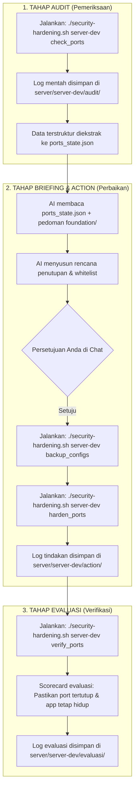

# 🛡️ Security Hardening Agent

Repositori ini adalah sistem automasi audit, remediasi, dan verifikasi keamanan server Linux berbasis AI (**Antigravity**) dengan mengadopsi siklus kerja standar industri: **Audit $\rightarrow$ Action $\rightarrow$ Evaluasi**.

---

## 📁 Struktur Direktori & Penjelasan File

Berikut adalah struktur lengkap repositori beserta peran masing-masing direktori dan filenya:

```text
security-agent/
├── .agents/                                  # Konfigurasi & Otak Bawaan AI Antigravity
│   └── skills/
│       └── server-hardening/
│           └── SKILL.md                      # Workflow & SOP resmi AI Antigravity (Memory Agent)
│
├── foundation/                               # Buku Pedoman & SOP Baku (Single Source of Truth)
│   ├── 01-incident-triage.md                 # SOP & checklist deteksi backdoor, cron, dan penyusup
│   ├── 02-network-and-ports.md               # SOP port 0.0.0.0, Docker iptables gotchas, & firewall
│   └── 03-auth-and-ssh.md                    # SOP pembuatan akun developer & hardening SSH key
│
├── scripts/                                  # Kumpulan Skrip Alat Kerja (Dibagi per Siklus)
│   ├── audit/                                # [TAHAP 1: PEMERIKSAAN / READ-ONLY]
│   │   ├── check_ports.sh                    # Cek port terbuka, firewall, & simpan ports_state.json
│   │   ├── check_triage.sh                   # Cek jejak cron asing, authorized_keys, proses /tmp
│   │   └── check_ssh_users.sh                # Cek konfigurasi login SSH & daftar user/sudoers
│   │
│   ├── action/                               # [TAHAP 2: TINDAKAN / PERBAIKAN]
│   │   ├── backup_configs.sh                 # Backup darurat config server (/etc/ssh, ufw, cron)
│   │   ├── harden_ports.sh                   # Terapkan UFW default deny & whitelist IP internal
│   │   └── create_developer_user.sh          # Buat akun developer mandiri dengan SSH Public Key
│   │
│   └── evaluasi/                             # [TAHAP 3: EVALUASI / VERIFIKASI]
│       └── verify_ports.sh                   # Scorecard validasi: memastikan port benar-benar aman
│
├── server/                                   # Database Log & State Nyata per Server
│   ├── server-dev/
│   │   ├── audit/                            # Log scan audit & ports_state.json (Memori Data)
│   │   ├── action/                           # Log eksekusi tindakan & catatan backup
│   │   └── evaluasi/                         # Log hasil scorecard verifikasi
│   └── server-prod/                          # (Struktur sama untuk server produksi lainnya)
│
├── security-hardening.sh                                  # Mesin Penggerak / Runner CLI Utama (JANGAN DIHAPUS)
├── .env.example                              # Template penyimpanan password/kredensial SSH
├── .env                                      # File kredensial lokal Anda (Otomatis di-ignore Git)
├── .gitignore                                # Proteksi agar log, json, dan password tidak masuk Git
└── README.md                                 # Dokumentasi arsitektur dan alur kerja proyek
```

---

### 🔍 Rincian Fungsi Tiap Folder & File

#### 1. `.agents/skills/server-hardening/SKILL.md` *(Workflow Bawaan Antigravity)*
- **Apa ini?** Ini adalah fitur resmi bawaan IDE Antigravity untuk menyimpan SOP dan instruksi AI.
- **Fungsinya:** Saat Anda membuka project ini di Antigravity, AI otomatis membaca file ini sehingga AI langsung paham peran, aturan keselamatan (*anti-lockout*), dan alur eksekusi tanpa Anda harus membuat prompt dari nol.

#### 2. `foundation/` *(Buku Pedoman / Standar Acuan Baku)*
- **Apa ini?** *Single Source of Truth* yang berisi pedoman keamanan teoretis dan checklist teknis.
- **Fungsinya:** Menjadi acuan pembanding. `foundation/` diorganisir berdasarkan **Topik Keamanan** (Incident Triage, Network/Ports, Auth/SSH), bukan per server.

#### 3. `scripts/` *(Alat Eksekusi Teknis)*
- **`scripts/audit/`**: Skrip **100% Read-Only**. Tugasnya memotret kondisi riil server tanpa mengubah apa pun.
- **`scripts/action/`**: Skrip **Eksekusi Perbaikan**. Tugasnya mengubah konfigurasi sistem (backup dulu, terapkan firewall UFW, buat user baru).
- **`scripts/evaluasi/`**: Skrip **Verifikasi Post-Action**. Tugasnya memastikan bahwa perubahan yang dilakukan berhasil dan tidak merusak koneksi aplikasi yang sah.

#### 4. `server/<nama-server>/` *(Tempat Log & Memori Data)*
- Setiap server target (misal: `server-dev`, `server-prod`) memiliki foldernya sendiri dengan 3 sub-folder yang mencerminkan siklus kerja:
  - `audit/`: Berisi riwayat scan dan **`ports_state.json`** (file state terstruktur yang menjadi jembatan memori ke tahap Action).
  - `action/`: Berisi riwayat eksekusi perbaikan.
  - `evaluasi/`: Berisi riwayat verifikasi scorecard.

#### 5. `security-hardening.sh` *(Mesin Penggerak / CLI Runner)*
- **Kenapa ini penting dan JANGAN dihapus?**
  File ini adalah jembatan penghubung antara file kredensial `.env`, alias SSH di Mac Anda, skrip di `scripts/`, dan penyimpanan log di `server/`. Tanpa `security-hardening.sh`, Anda harus mengetik perintah SSH yang panjang dan rumit secara manual.

---

## 🔄 Alur Kerja Project (The Security Lifecycle)

Siklus kerja project ini terbagi menjadi 3 langkah berurutan:



### Langkah demi Langkah:

1. **Tahap Audit (Mengetahui Masalah):**
   Anda menjalankan pemeriksaan:
   ```bash
   ./security-hardening.sh server-dev check_ports
   ```
   Skrip akan menampilkan daftar port publik ke layar, mencatat log ke `server/server-dev/audit/`, dan otomatis membentuk file memori **`ports_state.json`** yang mencatat port database berbahaya serta IP internal yang sedang terhubung.

2. **Tahap Action (Memperbaiki Masalah):**
   - AI membaca `ports_state.json` dan memadukannya dengan aturan di `foundation/02-network-and-ports.md`.
   - AI mempresentasikan rencana ke Anda: *"Port Postgres 5432 terbuka, tapi ada koneksi aktif dari IP 10.0.0.1. Kita akan pasang UFW dengan whitelist IP 10.0.0.1 dan allow SSH 22."*
   - Setelah Anda setuju di chat, tindakan dijalankan:
     ```bash
     # Langkah A: Cadangkan konfigurasi lama terlebih dahulu
     ./security-hardening.sh server-dev backup_configs

     # Langkah B: Terapkan aturan firewall dan whitelist
     ./security-hardening.sh server-dev harden_ports
     ```

3. **Tahap Evaluasi (Membuktikan Hasil):**
   Anda memvalidasi apakah server sudah benar-benar aman:
   ```bash
   ./security-hardening.sh server-dev verify_ports
   ```
   Sistem menampilkan **Scorecard Hasil**:
   - Status Firewall: LULUS (Aktif)
   - Status Port Database: LULUS (Akses publik 0.0.0.0 ditahan)
   - Status Akses SSH: LULUS (Port 22 tetap terbuka, aman dari lockout)
   - Status Aplikasi Internal: LULUS (Koneksi VPC tetap normal)

---

## 🛠️ Daftar Perintah CLI (`./security-hardening.sh`)

| Tahap | Perintah | Fungsi |
| :--- | :--- | :--- |
| **Audit Full** | `./security-hardening.sh <server> audit` | Menjalankan seluruh audit sekaligus (ports, triage, ssh) |
| **Audit** | `./security-hardening.sh <server> check_ports` | Memetakan port 0.0.0.0, siapa yang konek, dan status firewall |
| **Audit** | `./security-hardening.sh <server> check_triage` | Memeriksa sisa cron job asing, SSH key duplikat, dan malware |
| **Audit** | `./security-hardening.sh <server> check_ssh_users` | Memeriksa aturan login SSH dan akun yang memiliki hak sudo |
| **Action** | `./security-hardening.sh <server> backup_configs` | Membuat cadangan file konfigurasi sensitif ke `/var/backups/` |
| **Action** | `./security-hardening.sh <server> harden_ports` | Mengaktifkan UFW default deny + whitelist IP internal |
| **Action** | `./security-hardening.sh <server> create_developer_user` | Membuat akun developer baru dengan SSH Public Key mandiri |
| **Evaluasi** | `./security-hardening.sh <server> verify_ports` | Menjalankan scorecard verifikasi keberhasilan penutupan port |
