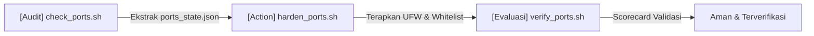

# Foundation 02: Network & Exposure (Port & Firewall)

Modul ini adalah buku pedoman utama untuk mengamankan port publik `0.0.0.0`, menerapkan aturan firewall UFW anti-lockout, serta memahami interaksi penting antara **Docker dan Firewall**.

---

## 1. Siklus Hardening Port: Audit $\rightarrow$ Action $\rightarrow$ Evaluasi



1. **Audit (scripts/audit/check_ports.sh):**
   - Memetakan semua port yang listen di `0.0.0.0` vs `127.0.0.1`.
   - Mengelompokkan port database sensitif (3306, 5432, 27017, 6379, 9042, 5672).
   - Mendeteksi koneksi aktif internal untuk dicatat ke `server/<server>/audit/ports_state.json`.
2. **Action (scripts/action/harden_ports.sh):**
   - Menyetel default policy: `DENY incoming`, `ALLOW outgoing`.
   - Mengizinkan port SSH terlebih dahulu agar tidak terkunci.
   - Mengizinkan subnet internal (10.0.0.0/8, 172.16.0.0/12, 192.168.0.0/16) agar service seperti Postgres dan RabbitMQ tetap bisa diakses aplikasi internal.
   - Mengaktifkan UFW.
3. **Evaluasi (scripts/evaluasi/verify_ports.sh):**
   - Memeriksa scorecard: Status UFW (Aktif/Nonaktif), status proteksi port database, dan kontinuitas traffic internal.

---

## 2. Catatan Khusus Docker (Docker Port Exposure Gotcha)

> [!IMPORTANT]
> **PERINGATAN KRITIS TENTANG DOCKER:**
> Secara default, Docker memanipulasi `iptables` secara langsung. Jika sebuah container dijalankan dengan `-p 3306:3306` (atau di `docker-compose.yml` tertulis `ports: - "3306:3306"`), Docker akan mengekspos port tersebut ke `0.0.0.0` dan **bisa membypass UFW biasa**!

### Cara Mengamankan Port Docker:
Ada 2 metode yang direkomendasikan:

1. **Metode 1: Bind ke Localhost di `docker-compose.yml` (Paling Aman)**
   Ubah pemetaan port agar hanya mendengarkan di `127.0.0.1`:
   ```yaml
   # SEBELUM (Terbuka ke publik):
   ports:
     - "3306:3306"
     - "5432:5432"

   # SESUDAH (Hanya bisa diakses lokal):
   ports:
     - "127.0.0.1:3306:3306"
     - "127.0.0.1:5432:5432"
   ```

2. **Metode 2: Menggunakan UFW Subnet Rules**
   Jika container harus diakses oleh server lain dalam VPC (misal IP `10.0.0.1`), gunakan UFW allow berbasis subnet internal:
   ```bash
   sudo ufw allow from 10.0.0.0/8 to any port 5432 proto tcp comment 'Postgres VPC'
   ```

---

## 3. Strategi Akses Remote Database Tanpa Buka Port Publik
Jika developer butuh membuka database (MySQL/Postgres/FerretDB) dari laptop lokal menggunakan GUI (DBeaver, Navicat, MongoDB Compass):
- **JANGAN PERNAH** membuka port 3306/5432 ke `0.0.0.0`.
- **Gunakan SSH Tunneling:**
  ```bash
  # Forward port 5432 server ke port 5433 di laptop lokal:
  ssh -L 5433:127.0.0.1:5432 server-dev
  ```
  Lalu di DBeaver, sambungkan ke `localhost:5433`. Aman 100% dan terenkripsi lewat SSH.
